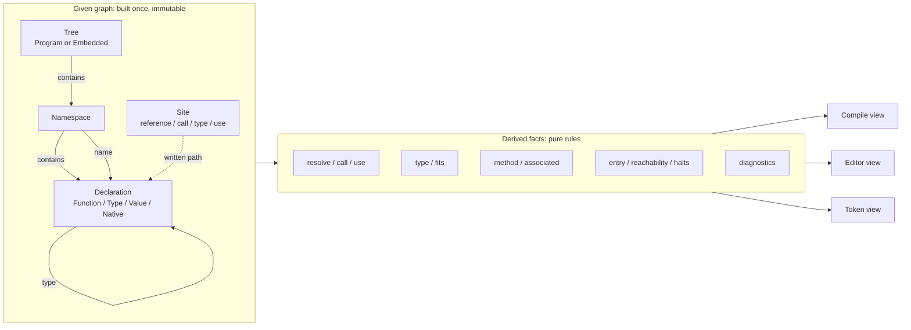
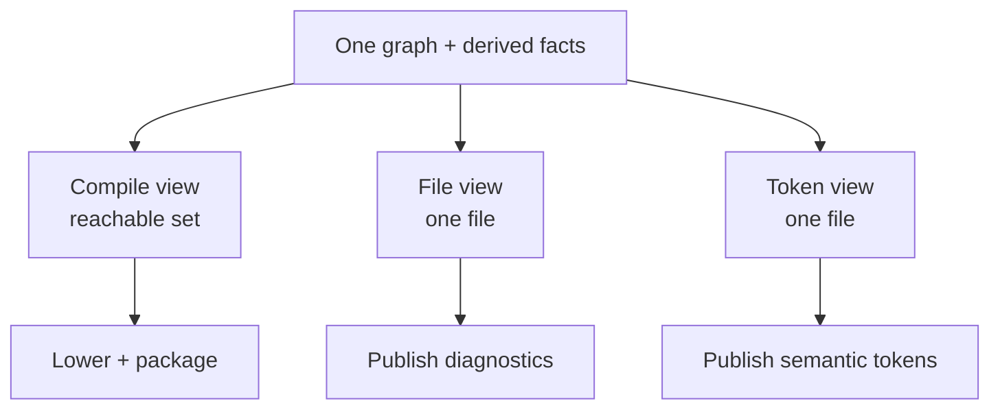

# The Fact Graph

**Status:** proposal, not implemented.  
**Scope:** the compiler and analysis backend of kiru.  
**Goal:** scale the language and the editor without adding another special case for every rule.

---

## 1. The short version

Kiru should have one semantic graph and one way to derive facts from it.

```
kiru.toml + source files
        │
        ▼
   given graph          one writer, immutable after construction
        │
        ▼
   derived facts        pure rules, memoized, evaluated to a fixed point
        │
        ├──────────────► compile view   (reachable declarations, lowered)
        ├──────────────► editor view    (the open file's facts)
        └──────────────► token view     (roles painted over the source)
```

The given graph is built once. Every later answer — a name's declaration, a call's target, a type, reachability, halting, a warning — is a derived fact computed by a rule. No pass rewrites the graph. A view is a read-only slice of the same facts.

This is not a new database server and it is not a second language. It is a shape for the backend we already have: one node family, one edge family, one place where each rule lives, one verifier.

---

## 2. Why the current backend cannot scale

The current graph is implicit. It lives inside expression nodes, name tables, method tables, use deliveries, and a few builder-only side tables. Every consumer walks it again.

| Current symptom | Where it shows | Consequence | This design |
|---|---|---|---|
| Types are not declaration nodes | `register_declarations.rs` reserves a `TypeDecl` and returns before declaring a node | `Rec`/`Enum` arms are dead in declaration passes; type references are not graph edges; types are never pruned | A type is a declaration form with one id; type references are edges |
| The checker writes edges | `expression_typing.rs` replaces a method family with a reference | The graph means different things before and after checking; a resolve-only consumer sees an incomplete graph | Resolution is a derived fact; the given graph is never written by a pass |
| Prune renumbers every declaration | `prune/declarations.rs` compacts and remaps by hand | Every edge must be rewritten; `brought` is missed; verification is debug-only | Stable ids; pruning is a view, not a rewrite |
| Six independent walkers | reachability, reads, remap, verifier, semantic, checker/lower | A new edge must be added in several places; a missed one is silent or a panic | The schema owns traversal; rules read relations |
| Use status is outside the graph | `Builder.used_uses`, `brought`, warning pass, semantic pass | The same delivery is resolved and judged more than once; duplicates were once called unused | A delivery is a derived fact with a status |
| Paths and names decide semantics | `is_absolute`, `<std>`, `root`, `main`, `std`, list path | The model has special cases that every pass must remember | Tree origin, entry, list, and natives are declared facts |
| Verification is range-only and debug-only | `verify_graph.rs` checks ids, not relations | A table can point at the wrong name or namespace and still pass | A full relational verifier at every boundary |
| Diagnostics are hand-written per case | one function and one message per fact | Adding one warning touches the enum, policy, config, and a pass | Rules emit diagnostic facts through one report |

The two recent warning patches — the receiver exemption and the redundant-use classification — are symptoms of this shape, not separate bugs. A binding-role fact and a delivery-status fact would have made both rules ordinary.

---

## 3. What the research says

These systems solve parts of the same problem. None should be copied whole; each contributes one idea.

| System | Central idea, in plain terms | What to take | What to leave |
|---|---|---|---|
| **rust-analyzer + Salsa** | A program is a set of pure queries; answers are remembered and recomputed only when their inputs change | Ground inputs vs derived state; query cache; dependency tracking; durability for stable inputs; body edits do not invalidate global facts | Salsa's full machinery at the start; a hand-rolled cache is enough until it is not |
| **rustc query system** | Each fact is a memoized function of a key, with a dependency graph | One query per fact; lazy evaluation; providers; incremental soundness from the dependency graph | The scale of a full compiler query system |
| **Glean** | Facts are typed, schema-defined rows; derived facts are rules over them; storage is incremental | A schema for nodes and edges; derived predicates; a query language for tooling; one fact store for many clients | A separate database process and an external query language |
| **CodeQL** | A codebase is extracted into one relational schema and queried | The schema is the interface; queries are independent of extraction; diagnostics are query results | Running a separate extraction build |
| **Code Property Graph (Joern)** | Syntax, control flow, and data flow are one property graph with typed nodes and labeled edges | One graph, labeled edges, attributes, overlays for views | A universal graph database; kiru needs a small semantic graph |
| **MLIR** | Passes transform an IR; analyses read it; verifiers enforce invariants; passes are isolated | Transformation vs analysis; verifier after a pass; pass isolation; parallel work on independent units | Multi-level dialects; kiru has one semantic level before lowering |
| **Differential dataflow** | Relations are collections; changes flow through joins and fixed points incrementally | Incremental relational evaluation; fixed points; arbitrary additions and removals | Distributed workers at the start |
| **JastAdd / reference attribute grammars** | A compiler is a set of declarative attributes over a tree; circular attributes solve flow by iteration | Attributes as pure facts; fixed points for flow; extension by adding equations, not editing passes | Generated Java-style code generation |

Two conclusions from the comparison:

1. **The graph must be given, not grown by passes.** Salsa and rustc separate inputs from derived facts; MLIR separates transformations from analyses. The current checker mixing resolution into mutation is the opposite.
2. **The schema must own traversal and verification.** Glean and CodeQL make the schema the interface; MLIR makes the verifier part of the pipeline. The current code has a schema in the type-group table only, not for the reference graph.

---

## 4. Terms, without the jargon

| Term | Plain meaning | In this design |
|---|---|---|
| **Given fact** | Something read directly from the source or the manifest | A namespace, a declaration, a written name, a body, a use statement |
| **Derived fact** | Something computed from given facts | A resolved reference, a type, a method choice, reachability, halting, a diagnostic |
| **Rule** | A pure function from facts to facts | Name resolution, type checking, method selection, flow |
| **Fixed point** | Repeat a rule until it adds nothing new | Halting and reachability over cycles |
| **View** | A filtered, read-only projection | Compile view, editor view, token view |
| **Query cache** | Remember an answer and reuse it when its inputs did not change | Per-node and per-file memoization |
| **Verifier** | A check that the graph obeys its own rules | Edge endpoints, ownership, name keys, binding facts |
| **Site** | A place in a body where a name, call, type, or use is written | The stable identity of a reference before it is resolved |
| **IR** | The form a program takes between compiler stages | The syntax tree before lowering; bytecode after |
| **Datalog** | A rule language over tables, like SQL views that can call each other | The shape of the derived rules; not a required engine |
| **Red-green** | A cache check that recomputes only when an input actually changed | Incremental invalidation after a file edit |
| **Property graph** | A graph whose nodes and edges carry types and named attributes | The given graph's nodes, edges, and spans |

---

## 5. The model

### 5.1 Syntax stays a tree

The parser already produces a tree. It should remain a tree: expressions and statements are not graph nodes. Only **semantic sites** become nodes:

- a name reference,
- a call,
- a written type,
- a `use` statement,
- a binding (parameter, local, pattern binding).

Each site has a stable id, a file, a span, and the written path. The body tree is immutable and is attached to its function. This keeps the graph small and keeps syntax errors and incomplete code easy to represent.

### 5.2 One declaration node

```
Declaration
├── id
├── form: Function | Type | Value | Native
├── name, span, namespace, file
├── visibility
├── binding: Free | Method(receiver) | Associated(type)   (functions only)
├── signature
└── payload:
    Function { body, parameters, captures }
    Type     { fields | variants, runtime shape }
    Value    { initializer }
    Native   { handler, signature }
```

A `rec`, an `enum`, a function, a module value, and a native are all declarations. A type is not a second table with a parallel name. A method and an associated function differ by one binding fact, not by a declaration kind that every pass must reinterpret.

The type parameters and fields are members of the type declaration. A method's receiver is the first parameter of a function whose binding says `Method`.

### 5.3 One edge family

Every relation is an edge with a kind, a source, a target, and the source span that explains it.

| Edge | From → To | Meaning | Required invariant |
|---|---|---|---|
| `contains` | Tree / Namespace / File → Declaration | Ownership | Every declaration has exactly one owner |
| `name` | Namespace → Declaration | A name in a namespace | The key is the declaration's name; a duplicate is a derived diagnostic |
| `member` | Type → Field / Variant | A type's shape | A member belongs to one type |
| `type` | Declaration / Site → Type | A declared or inferred type | The target is a type declaration |
| `resolve` | Ref site → Declaration | What a written name means | The declaration is visible from the site's namespace |
| `call` | Call site → Declaration | What a call runs | The callee is callable |
| `use` | Use site → Declaration / Namespace | What a use brings in | The target is a namespace, type, or free function |
| `delivery` | Namespace + name → target | What a use delivers | The status is one derived fact: taken, unused, redundant, shadowed |
| `owner` | Member → Function | Which body owns a parameter or local | The owner is a function |
| `capture` | Function → Local | A closure reads an outer local | The local is owned by an enclosing function |
| `entry` | Tree → Declaration | Where the program starts | Exactly one for a program tree; none for the embedded library |
| `origin` | Tree → Program / Embedded | Why the tree exists | A program tree comes from the manifest; the library is compiler input |

Names, methods, associates, use deliveries, module-value order, and type references are all edges. There are no parallel name/method/type tables whose keys can disagree with the nodes.

### 5.4 The manifest is the only program tree

`kiru.toml` names the program tree and the output. The tree node records its origin: `Program` or `Embedded`. The embedded library is a tree with origin `Embedded`, not a path heuristic. A file is in a tree because the tree contains it, not because its path is absolute or under a directory named `std`.

The editor analyzes the tree the manifest names. It publishes the open file's facts. It has no mode and no second tree.

### 5.5 The graph in one picture



The dashed line is the important one: a site knows the **written path**, not a declaration id. Resolution is derived. That is what removes the checker's mutation and the before/after graph shapes.

### 5.6 Where this lives in the repository

The existing directories keep their meaning; the data they exchange changes.

| Today | Role in the Fact Graph |
|---|---|
| `src/syntax/` | Parser and immutable body trees |
| `src/project/` | Manifest and the tree's origin |
| `src/compiler/model/` | Given graph, schema, and generated indexes |
| `src/compiler/compile/resolve/` | Builder plus name, type-site, and use rules |
| `src/compiler/compile/check/` | Type, method, and flow rules; read-only |
| `src/compiler/compile/prune/` | Compile view (reachable set) |
| `src/compiler/analyze/` | Editor and token views |
| `src/compiler/diagnostic.rs` | The one report |
| `src/lsp/` | Publication of the editor view |
| `src/compiler/bytecode/`, `src/runtime/` | Lowering and execution; no semantic graph |

The public shape is deliberately small:

```rust
let graph = build(&project, &source)?;   // given facts, read-only
let facts = derive(&graph)?;             // derived facts, read-only
let view  = compile_view(&graph, &facts); // reachable set, stable ids
```

No stage receives `&mut Graph`.

---

## 6. Rules

A rule is a pure relation. It reads given or derived facts and produces new facts. It never edits the graph. The same rule is the only place its diagnostic can be produced.

| Rule | Reads | Produces | Fixed point |
|---|---|---|---|
| Names | `name`, `contains`, visibility | visible name facts, duplicate diagnostics | No |
| Types | written type sites, type declarations, arguments | `type` facts, arity/kind diagnostics | No |
| Method selection | receiver type, `binding`, `name` | `call` facts for method and associated calls | No (after type facts) |
| Uses | use sites, namespace names | `use` and `delivery` facts, status | No |
| Entry | root namespace, `name`, signature | `entry` fact, entry-shape diagnostics | No |
| Reachability | `entry`, `resolve`, `call`, `type`, `owner`, `capture` | reachable declaration set | Yes |
| Halting | call graph, statements | `halts` fact per body | Yes |
| Unused | reachability, bindings, uses, declarations | unused facts | No |
| Tokens | declarations, sites, syntax tokens | roles per span | No |
| Diagnostics | every rule's emitted facts | one ordered report | No |

The fixed points are small and explicit. Halting already uses a fixpoint; reachability is a graph closure. Neither needs a general solver.

### 6.1 What a rule looks like in practice

Method dispatch is the clearest example:

```
for each call site with a method family and a receiver:
    receiver_type = type_of(receiver)
    candidate = the declaration where:
        binding == Method
        receiver_type.head == binding.receiver
        name matches
        visible from the call's namespace
    emit call(site, candidate)
```

No pass writes the candidate into the body. The call site keeps its written path; the derived `call` fact is what later passes read. If the receiver's type changes, the fact is invalidated and recomputed. There is no phase at which a `Method` callee exists but a `Reference` callee does not.

The same shape handles:

- a bound function value (`Type.name`),
- an associated function (`Type.name(...)`),
- a plain call,
- a use delivery,
- a type annotation.

---

## 7. Views

A view is a filtered read. It does not copy or renumber the graph.

| View | Content | Consumer |
|---|---|---|
| **Compile** | The entry, its reachable declarations, their types, and the facts lowering needs | `lower`, package |
| **Editor** | Every fact whose site is in the open file | `kc lsp` |
| **Token** | The role of every token in one file | `kc lsp` |
| **Verification** | Whole graph | verifier, tests |

Pruning is the compile view: a reachable set over stable ids. Lowering may renumber its own bytecode; it does not renumber the model. If a payload must be compact, that compaction belongs to the serialization boundary, not to the semantic graph.



The compile and editor processes read the same facts. The editor never runs a second analyzer with different rules.

---

## 8. Consistency rules

These are the invariants the verifier enforces. They are not documentation; they are checks.

| # | Invariant | Checked after |
|---|---|---|
| 1 | Every node has exactly one kind and one owner | Build |
| 2 | Every edge endpoint exists and has the required kind | Build, derive |
| 3 | Every name edge's key equals the target's name, and the target's namespace equals the source namespace | Build |
| 4 | Every declaration is contained by exactly one file and one namespace | Build |
| 5 | Every parameter/local is owned by exactly one function; every capture is an outer local | Build |
| 6 | A method's binding receiver equals its first parameter's type; an associated function has no receiver | Build |
| 7 | Every type edge points at a type declaration; every type argument count matches | Derive |
| 8 | Every resolved site's declaration is visible from the site's namespace | Derive |
| 9 | Every delivery's status is exactly one of taken, unused, redundant, shadowed | Derive |
| 10 | The entry is a root-namespace function with the declared shape; a program tree has exactly one | Derive |
| 11 | Reachability is closed under the resolved edges: no reachable body points at an unreachable declaration | Derive |
| 12 | Every source diagnostic names a rule, a severity, a site, and a span | Report |
| 13 | A view contains no node or edge outside the graph it came from | View |

Two more rules are structural rather than relational:

- **One writer.** Only the builder creates given facts. Every later stage has a read-only handle.
- **No semantic side tables.** If a fact is semantic, it is a node, edge, or derived relation. There is no `filed` set, no `used_uses` set, no `type_uses` span list outside the graph. Indexes and query caches are generated from the schema and are disposable; they are never a source of truth.

The verifier runs after build, after derive, and after a view is produced. In development it panics on a violation; in release it returns a structured error at the boundary instead of silently continuing. A release build does not skip graph verification; it runs the cheap invariants and the full check on a debug flag.

---

## 9. Scaling

The graph is stable, so scaling is about work avoided, not work rewritten.

| Problem | Current cost | Fact Graph response |
|---|---|---|
| Editing one body | Re-resolve the whole tree | Body queries depend on the file; global facts depend on signatures only |
| Adding a warning | Edit enum, policy, config, pass | Add one rule row; the report discovers it |
| Pruning | Renumber every declaration and rewrite every edge | Compute a reachable set; keep ids |
| Editor request | Re-run the analyzer | Read cached derived facts for the file |
| Large codebase | One process, one pass | Per-file parse/build in parallel; per-namespace rules; deterministic merge |
| Repeated std | Parse and check std every run | Durable embedded tree; its facts are cacheable for the session |
| Cyclic flow | Manual two-phase pass | Fixed point in the halting rule |

### 9.1 Incremental shape


The key dependency rule is the one rust-analyzer states for its own compiler layer: **typing inside a function body must not invalidate global derived data**. A body edit invalidates that body's sites and type facts. It does not invalidate another function's signature, another namespace's names, or the method table unless the signature changed.

The first implementation does not need a full Salsa dependency graph. A small cache keyed by `(node id, revision)` with a recorded dependency list is enough. The interface should be query-shaped from the start so the engine can be replaced without changing rules.

### 9.2 When differential dataflow is worth it

Differential dataflow is attractive for reachability and fixed points over very large graphs because it updates only the affected part. It is not needed for a 100k-line codebase. The design keeps the relation layer separate so it can be swapped in later without changing the schema or the rules.

### 9.3 Parallelism

- Files parse and build independently.
- Namespaces resolve independently once names are collected.
- Type checking is per body.
- Reachability and halting are global fixed points; they run after the parallel layers.
- Results are merged in id order, so the output is deterministic.

---

## 10. Migration plan

The migration is staged so every stage has a proof and none requires a flag day.

| Stage | Change | Behavior | Proof |
|---|---|---|---|
| **0. Verifier** | Add the full relational verifier over the current model; run it after resolve, check, and prune | Unchanged | All existing tests; the verifier may report the graph defects listed in section 2 |
| **1. Freeze the checker** | Move method selection, variant binding types, match exhaustiveness, and halting into derived facts; stop rewriting bodies | Same output | Payload sha unchanged; graph verifier green |
| **2. Types as declarations** | One declaration form for types; remove the parallel type identity; add type edges | Same output | Payload sha unchanged; no dead `Rec`/`Enum` arms |
| **3. Delivery facts** | Use sites and delivery status are derived facts; remove `used_uses`, the warning re-resolution, and the redundant-use special case | Same warnings | Warning tests; the duplicate case is one status, not a special rule |
| **4. Declared special facts** | Entry, list, native body, and tree origin are nodes/facts; remove `is_absolute`, `<std>`, `main`, list-path checks from passes | Same output | Payload sha unchanged; LSP requires the manifest |
| **5. Prune as a view** | Stable ids; reachable set; lowering filters; no remap | Same payload | Payload sha unchanged; no remapping code |
| **6. One report** | Every diagnostic is a rule fact; remove per-kind plumbing | Same warnings/errors | All diagnostics still reported; no config |
| **7. Incremental layer** | Query cache, durable embedded tree, per-file invalidation | Same results, faster | Cold/warm LSP timings; same diagnostics and tokens |
| **8. Parallel layer** | Per-file and per-namespace work in parallel; deterministic merge | Same results | Byte-identical payload; graph verifier green |

The payload sha is the invariant for every behavior-preserving stage. A stage that changes a warning's semantics is not a refactor and needs the owner's word.

---

## 11. Alternatives considered

| Alternative | Why not, or when |
|---|---|
| **Keep the current graph and patch each bug** | It produced the receiver and redundant-use special cases. Every new rule adds another walker and another side table. |
| **Move everything into a general Datalog database (Glean/CodeQL style)** | Excellent for extensibility and queries, but it adds a storage engine, a query language, and a second source of truth. The schema and derived-predicate ideas are borrowed without the process. |
| **Use Salsa for everything** | Salsa gives incremental queries, not a graph schema or relational invariants. It is the right cache layer, not the model. |
| **MLIR-style multiple IRs** | Good for lowering and optimization, but the semantic graph is the thing that needs one shape. Lowering can have its own IR; the graph before it should not fork. |
| **Reference attribute grammars only** | The declarative-attribute and fixed-point ideas are right. A full attribute-grammar generator would replace the Rust codebase with generated code and hide the graph from tooling. |
| **Keep types outside declarations, add a `TypeId` link** | It preserves the two-identity problem and the dead kind arms. A type is a declaration form. |

---

## 12. Risks and non-goals

| Risk | Mitigation |
|---|---|
| The graph is larger than the current model | Only semantic sites are nodes; bodies stay trees; ids are compact; indexes are generated from the schema |
| Fixed points can be slow | Start with reachability and halting; they are small; cache per revision |
| Incremental invalidation is hard to get right | Start with whole-file recomputation and a correct cache; add red-green only after the verifier is trusted |
| The migration touches every pass | Stage 0 verifier and the payload gate; each stage is independently revertible |
| A general rule engine becomes a second language | Rules are Rust functions with typed inputs and outputs; no external DSL at first |
| Graph verification costs time | Run full checks in development; run cheap invariants in release; make the full check a flag |

**Non-goals**

- No external graph database.
- No distributed analysis at the start.
- No new configuration for diagnostics, LSP modes, or project kinds.
- No change to the language's semantics as part of the refactor.

---

## 13. Definition of done

The backend is consistent when all of these are true:

- [ ] A pass cannot mutate the given graph; the API hands out read-only views.
- [ ] A type is a declaration with one id; no parallel type identity exists.
- [ ] A method and an associated function differ by a binding fact, not by a pass's interpretation.
- [ ] A call site keeps its written path; its target is a derived fact.
- [ ] A use delivery has one status fact; no warning pass re-resolves it.
- [ ] Entry, list, native, and tree origin are declared facts; no pass tests a path or a name for them.
- [ ] Pruning is a reachable set; no declaration is renumbered and no edge is remapped.
- [ ] Every diagnostic names a rule, a severity, a site, and a span; there is one report.
- [ ] The verifier checks the invariants in this document after build and derive: the full set in development, the cheap set in release, and the full set on demand in release.
- [ ] The compile and editor processes read the same facts.
- [ ] The payload sha is unchanged for every behavior-preserving stage.

---

## 14. Sources

- rust-analyzer architecture — ground state vs derived state, Salsa, API boundaries, incrementality: <https://rust-analyzer.github.io/book/contributing/architecture.html>
- Salsa overview — queries, inputs, memoization, accumulators: <https://salsa-rs.github.io/salsa/overview.html>
- rustc query system — demand-driven compilation and dependency graphs: <https://rustc-dev-guide.rust-lang.org/query.html>
- Glean — typed facts, schema, derived predicates: <https://glean.software/docs/introduction/> and <https://glean.software/docs/derived/>
- CodeQL — one relational database and a schema per language: <https://codeql.github.com/docs/codeql-overview/about-codeql/>
- Code Property Graph — typed nodes, labeled edges, one graph for syntax and flow: <https://docs.joern.io/code-property-graph/>
- MLIR pass infrastructure — passes vs analyses, isolation, verifier discipline: <https://mlir.llvm.org/docs/PassManagement/>
- Differential dataflow — incremental relations and fixed points: <https://github.com/timelydataflow/differential-dataflow>
- JastAdd — declarative compiler attributes and fixed points: <https://github.com/jastadd/jastadd>
