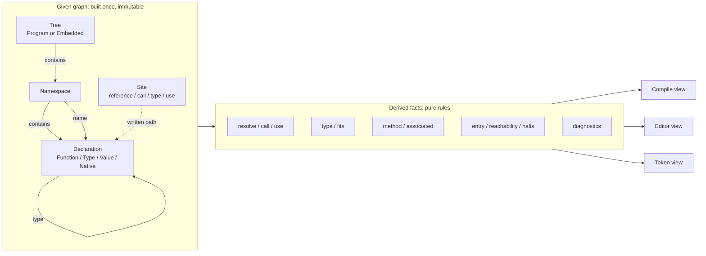
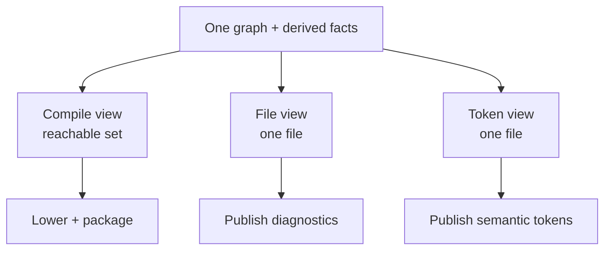

# The Fact Graph

**Status:** implemented.
**Scope:** the compiler and analysis backend of kiru.
**Goal:** scale the language and the editor without adding another special case for every rule.

---

## 1. The short version

Kiru should have one semantic graph and one way to derive facts from it.

```
kiru.toml + source files
        │
        ▼
   given graph          one writer, immutable after construction
        │
        ▼
   derived facts        pure rules, memoized, evaluated to a fixed point
        │
        ├──────────────► compile view   (reachable declarations, lowered)
        ├──────────────► editor view    (the open file's facts)
        └──────────────► token view     (roles painted over the source)
```

The given graph is built once. Every later answer — a name's declaration, a call's target, a type, reachability, halting, a warning — is a derived fact computed by a rule. No pass rewrites the graph. A view is a read-only slice of the same facts.

This is not a new database server and it is not a second language. It is a shape for the backend we already have: one node family, one edge family, one place where each rule lives, one verifier.

---

## 3. What the research says

These systems solve parts of the same problem. None should be copied whole; each contributes one idea.

| System | Central idea, in plain terms | What to take | What to leave |
|---|---|---|---|
| **rust-analyzer + Salsa** | A program is a set of pure queries; answers are remembered and recomputed only when their inputs change | Ground inputs vs derived state; query cache; dependency tracking; durability for stable inputs; body edits do not invalidate global facts | Salsa's full machinery at the start; a hand-rolled cache is enough until it is not |
| **rustc query system** | Each fact is a memoized function of a key, with a dependency graph | One query per fact; lazy evaluation; providers; incremental soundness from the dependency graph | The scale of a full compiler query system |
| **Glean** | Facts are typed, schema-defined rows; derived facts are rules over them; storage is incremental | A schema for nodes and edges; derived predicates; a query language for tooling; one fact store for many clients | A separate database process and an external query language |
| **CodeQL** | A codebase is extracted into one relational schema and queried | The schema is the interface; queries are independent of extraction; diagnostics are query results | Running a separate extraction build |
| **Code Property Graph (Joern)** | Syntax, control flow, and data flow are one property graph with typed nodes and labeled edges | One graph, labeled edges, attributes, overlays for views | A universal graph database; kiru needs a small semantic graph |
| **MLIR** | Passes transform an IR; analyses read it; verifiers enforce invariants; passes are isolated | Transformation vs analysis; verifier after a pass; pass isolation; parallel work on independent units | Multi-level dialects; kiru has one semantic level before lowering |
| **Differential dataflow** | Relations are collections; changes flow through joins and fixed points incrementally | Incremental relational evaluation; fixed points; arbitrary additions and removals | Distributed workers at the start |
| **JastAdd / reference attribute grammars** | A compiler is a set of declarative attributes over a tree; circular attributes solve flow by iteration | Attributes as pure facts; fixed points for flow; extension by adding equations, not editing passes | Generated Java-style code generation |

Two conclusions from the comparison:

1. **The graph must be given, not grown by passes.** Salsa and rustc separate inputs from derived facts; MLIR separates transformations from analyses. The current checker mixing resolution into mutation is the opposite.
2. **The schema must own traversal and verification.** Glean and CodeQL make the schema the interface; MLIR makes the verifier part of the pipeline. The current code has a schema in the type-group table only, not for the reference graph.

---

## 4. Terms, without the jargon

| Term | Plain meaning | In this design |
|---|---|---|
| **Given fact** | Something read directly from the source or the manifest | A namespace, a declaration, a written name, a body, a use statement |
| **Derived fact** | Something computed from given facts | A resolved reference, a type, a method choice, reachability, halting, a diagnostic |
| **Rule** | A pure function from facts to facts | Name resolution, type checking, method selection, flow |
| **Fixed point** | Repeat a rule until it adds nothing new | Halting and reachability over cycles |
| **View** | A filtered, read-only projection | Compile view, editor view, token view |
| **Query cache** | Remember an answer and reuse it when its inputs did not change | Per-node and per-file memoization |
| **Verifier** | A check that the graph obeys its own rules | Edge endpoints, ownership, name keys, binding facts |
| **Site** | A place in a body where a name, call, type, or use is written | The stable identity of a reference before it is resolved |
| **IR** | The form a program takes between compiler stages | The syntax tree before lowering; bytecode after |
| **Datalog** | A rule language over tables, like SQL views that can call each other | The shape of the derived rules; not a required engine |
| **Red-green** | A cache check that recomputes only when an input actually changed | Incremental invalidation after a file edit |
| **Property graph** | A graph whose nodes and edges carry types and named attributes | The given graph's nodes, edges, and spans |

---

## 5. The model

### 5.1 Syntax stays a tree

The parser already produces a tree. It should remain a tree: expressions and statements are not graph nodes. Only **semantic sites** become nodes:

- a name reference,
- a call,
- a written type,
- a `use` statement,
- a binding (parameter, local, pattern binding).

Each site has a stable id, a file, a span, and the written path. The body tree is immutable and is attached to its function. This keeps the graph small and keeps syntax errors and incomplete code easy to represent.

### 5.2 One declaration node

```
Declaration
├── id
├── form: Function | Type | Value | Native
├── name, span, namespace, file
├── visibility
├── binding: Named | Anonymous(containing) | Method(receiver) | Associated(type)   (functions only)
├── signature
└── payload:
    Function { body, parameters, captures }
    Type     { fields | variants, runtime shape }
    Value    { initializer }
    Native   { handler, signature }
```

A `rec`, an `enum`, a named function, an anonymous function, a module value, and a native are all declarations. A type is not a second table with a parallel name.

A named function, an anonymous function, a method, and an associated function share one `Function` form. Body, signature, type, flow, call behavior, and ownership are the same in every binding. The difference is the binding and its environment: a named function owns a namespace name and has no captures; an anonymous function owns no namespace name, is contained by the function or value whose body writes it, and captures the enclosing function locals it reads. A method's receiver is the first parameter of a function whose binding says `Method`; an associated function has no receiver. A closure literal in the surface is an anonymous function; `fn name(...)` is a named function, and `fn(types) -> result` is a function type.

A module value is not a function, but its initializer is a body: a match pattern binding written in that initializer is a local owned by the module value. A closure written in the initializer is an anonymous function and owns its own parameters and locals.

The type parameters and fields are members of the type declaration.

### 5.3 One edge family

Every relation is an edge with a kind, a source, a target, and the source span that explains it.

| Edge | From → To | Meaning | Required invariant |
|---|---|---|---|
| `contains` | Tree / Namespace / File / Function / Value → Declaration | Ownership | Every declaration has exactly one container: a file for a named declaration, the enclosing function or value for an anonymous one |
| `name` | Namespace → Declaration | A name in a namespace | The key is the declaration's name; only a named function, a value, a type, or a native has a name edge; a duplicate is a derived diagnostic |
| `member` | Type → Field / Variant | A type's shape | A member belongs to one type |
| `type` | Declaration / Site → Type | A declared or inferred type | The target is a type declaration |
| `resolve` | Ref site → Declaration | What a written name means | The declaration is visible from the site's namespace |
| `call` | Call site → Declaration | What a call runs | The callee is callable |
| `use` | Use site → Declaration / Namespace | What a use brings in | The target is a namespace, type, or free function |
| `delivery` | Namespace + name → target | What a use delivers | The status is one derived fact: taken, unused, or redundant; shadowed waits for a rule |
| `owner` | Member → Function / Value | Which body owns a parameter or local | The owner is a named or anonymous function, or the module value whose initializer declares the local |
| `capture` | Anonymous function → Local | A closure reads an outer local | The function is anonymous and the local is owned by an enclosing function |
| `entry` | Tree → Declaration | Where the program starts | Exactly one for a program tree; none for the embedded library |
| `origin` | Tree → Program / Embedded | Why the tree exists | A program tree comes from the manifest; the library is compiler input |

Names, methods, associates, captures, use deliveries, module-value order, and type references are all edges. A named function and an anonymous function are both `Function` nodes; only the named one has a `name` edge. The value-name, type-name, and method tables are indexes into those nodes; the verifier checks every key, and no table owns a second identity.

### 5.4 The manifest is the only program tree

`kiru.toml` names the program tree and the output. The tree node records its origin: `Program` or `Embedded`. The embedded library is a tree with origin `Embedded`, not a path heuristic. A file is in a tree because the tree contains it, not because its path is absolute or under a directory named `std`.

The editor analyzes the tree the manifest names. It publishes the open file's facts. It has no mode and no second tree.

### 5.5 The graph in one picture



The dashed line is the important one: a site knows the **written path**, not a declaration id. Resolution is derived. That is what removes the checker's mutation and the before/after graph shapes.

### 5.6 Where this lives in the repository

The compiler tree follows the model.

```
src/compiler/
  graph.rs + graph/       # given: ids, nodes, edges, tables, facts, visitors
  derive.rs + derive/     # rules: resolve and check
  views.rs + views/       # compile reachable set, token roles
  verify.rs               # relational invariants
  compile.rs + compile/   # process: load, build, lower, package
  analyze.rs + analyze/   # process: editor diagnostics and tokens
  types/                  # type algebra (group facts), not the graph
  bytecode/
  native_registry.rs      # given native table
  diagnostic.rs           # one report
```

The compile process runs load, resolve, check, the reachable view, lower, and package. The analyzer reuses load, resolve, and check, then groups the facts by file and projects tokens. No stage receives `&mut Graph` after resolution.

### 5.7 Layering

Layer boundaries are enforced by Rust visibility and by structural tests, not by prose: for example, `src/syntax` may not import `crate::compiler`; `derive` may not mutate the graph; `views` may not import another view's private data. The directory map in this document is documentation, not a build input.

---

## 6. Rules

A rule is a pure relation. It reads given or derived facts and produces new facts. It never edits the graph. The same rule is the only place its diagnostic can be produced.

| Rule | Reads | Produces | Fixed point |
|---|---|---|---|
| Names | `name`, `contains`, visibility | visible name facts, duplicate diagnostics | No |
| Functions | written function sites, the enclosing namespace or body, parameters | `Function` nodes, binding facts, `owner` and `capture` edges | No |
| Types | written type sites, type declarations, arguments | `type` facts, arity/kind diagnostics | No |
| Method selection | receiver type, `binding`, `name` | `call` facts for method and associated calls | No (after type facts) |
| Uses | use sites, namespace names | `use` and `delivery` facts, status | No |
| Entry | root namespace, `name`, signature | `entry` fact, entry-shape diagnostics | No |
| Reachability | `entry`, `resolve`, `call`, `type`, `owner`, `capture` | reachable declaration set | Yes |
| Halting | call graph, statements | `halts` fact per body | Yes |
| Unused | reachability, bindings, uses, declarations | unused facts | No |
| Tokens | declarations, sites, syntax tokens | roles per span | No |
| Diagnostics | every rule's emitted facts | one ordered report | No |

The fixed points are small and explicit. Halting already uses a fixpoint; reachability is a graph closure. Neither needs a general solver.

### 6.1 What a rule looks like in practice

Method dispatch is the clearest example:

```
for each call site with a method family and a receiver:
    receiver_type = type_of(receiver)
    candidate = the declaration where:
        binding == Method
        receiver_type.head == binding.receiver
        name matches
        visible from the call's namespace
    emit call(site, candidate)
```

No pass writes the candidate into the body. The call site keeps its written path; the derived `call` fact is what later passes read. If the receiver's type changes, the fact is invalidated and recomputed. There is no phase at which a `Method` callee exists but a `Reference` callee does not.

The same shape handles:

- a bound function value (`Type.name`),
- an associated function (`Type.name(...)`),
- a plain call,
- a use delivery,
- a type annotation.

---

## 7. Views

A view is a filtered read. It does not copy or renumber the graph.

| View | Content | Consumer |
|---|---|---|
| **Compile** | The entry, its reachable declarations, their types, and the facts lowering needs | `lower`, package |
| **Editor** | Every fact whose site is in the open file | `kc lsp` |
| **Token** | The role of every token in one file | `kc lsp` |
| **Verification** | Whole graph | verifier, tests |

Pruning is the compile view: a reachable set over stable ids. Lowering may renumber its own bytecode; it does not renumber the model. If a payload must be compact, that compaction belongs to the serialization boundary, not to the semantic graph.



The compile and editor processes read the same facts. The editor never runs a second analyzer with different rules.

---

## 8. Consistency rules

These are the invariants the verifier enforces. They are not documentation; they are checks.

| # | Invariant | Checked after |
|---|---|---|
| 1 | Every node has exactly one kind and one containing declaration or file | Build |
| 2 | Every edge endpoint exists and has the required kind | Build, derive |
| 3 | Every name edge's key equals the target's name, and the target's namespace equals the source namespace | Build |
| 4 | Every declaration is contained by exactly one file, or by the function or value whose body writes it, and names exactly one namespace | Build |
| 5 | Every parameter/local is owned by exactly one function, named or anonymous, or by the module value whose initializer declares it; every capture is an outer local owned by an enclosing function; a named function has no captures | Build |
| 6 | A method's binding receiver equals its first parameter's type; an associated function has no receiver; a named function owns one namespace name; an anonymous function owns none | Build |
| 7 | Every type edge points at a type declaration; every type argument count matches | Derive |
| 8 | Every resolved site's declaration is visible from the site's namespace | Derive |
| 9 | Every delivery's status is exactly one of taken, unused, or redundant; shadowed waits for a rule | Derive |
| 10 | The entry is a root-namespace function with the declared shape; a program tree has exactly one | Derive |
| 11 | Reachability is closed under the resolved edges: no reachable body points at an unreachable declaration | Derive |
| 12 | Every source diagnostic names a rule, a severity, a site, and a span | Report |
| 13 | A view contains no node or edge outside the graph it came from | View |

Two more rules are structural rather than relational:

- **One writer.** Only the builder creates given facts. Every later stage has a read-only handle.
- **No semantic side tables.** If a fact is semantic, it is a node, edge, or derived relation. There is no `filed` set, no `used_uses` set, no `type_uses` span list outside the graph. Indexes and query caches are generated from the schema and are disposable; they are never a source of truth.

The relational verifier runs after build, after derive, and after a view is produced in development builds; a violation is a compiler bug and panics with its boundary, kind, and detail. Release builds keep the structural verifier compiled and use the release self-compile as the graph gate.

---

## 9. Alternatives considered

| Alternative | Why not, or when |
|---|---|
| **Keep the current graph and patch each bug** | It produced the receiver and redundant-use special cases. Every new rule adds another walker and another side table. |
| **Move everything into a general Datalog database (Glean/CodeQL style)** | Excellent for extensibility and queries, but it adds a storage engine, a query language, and a second source of truth. The schema and derived-predicate ideas are borrowed without the process. |
| **Use Salsa for everything** | Salsa gives incremental queries, not a graph schema or relational invariants. It is the right cache layer, not the model. |
| **MLIR-style multiple IRs** | Good for lowering and optimization, but the semantic graph is the thing that needs one shape. Lowering can have its own IR; the graph before it should not fork. |
| **Reference attribute grammars only** | The declarative-attribute and fixed-point ideas are right. A full attribute-grammar generator would replace the Rust codebase with generated code and hide the graph from tooling. |
| **Keep types outside declarations, add a `TypeId` link** | It preserves the two-identity problem and the dead kind arms. A type is a declaration form. |

---

## 10. Risks and non-goals

| Risk | Mitigation |
|---|---|
| The graph is larger than the current model | Only semantic sites are nodes; bodies stay trees; ids are compact; indexes are generated from the schema |
| Fixed points can be slow | Reachability and halting are small and bounded; no cache is needed yet |
| A general rule engine becomes a second language | Rules are Rust functions with typed inputs and outputs; no external DSL at first |
| Graph verification costs time | Run full checks in development; the release self-compile is the payload gate |

**Non-goals**

- No external graph database.
- No distributed analysis at the start.
- No new configuration for diagnostics, LSP modes, or project kinds.
- No change to the language's semantics as part of the refactor.

---

## 11. Definition of done

The backend is consistent when all of these are true:

- [x] A pass cannot mutate the given graph; the API hands out read-only views.
- [x] A type is a declaration with one id; no parallel type identity exists.
- [x] A named function, an anonymous function, a method, and an associated function share one Function form; they differ by a binding fact, not by a pass's interpretation.
- [x] Every parameter/local is owned by its function node, named or anonymous, or by the module value whose initializer declares it.
- [x] A call site keeps its written path; its target is a derived fact.
- [x] A use delivery has one status fact; no warning pass re-resolves it.
- [x] Entry, list, native, and tree origin are declared facts; no pass tests a path or a name for them.
- [x] Pruning is a reachable set; no declaration is renumbered and no edge is remapped.
- [x] Every diagnostic names a rule, a severity, a site, and a span; there is one report.
- [x] The full relational verifier runs in development; release keeps the structural verifier and the release self-compile is the graph gate.
- [x] The compile and editor processes read the same facts.
- [x] The release self-compile and release tests are the final gate.

---

## 12. Sources

- rust-analyzer architecture — ground state vs derived state, Salsa, API boundaries, incrementality: <https://rust-analyzer.github.io/book/contributing/architecture.html>
- Salsa overview — queries, inputs, memoization, accumulators: <https://salsa-rs.github.io/salsa/overview.html>
- rustc query system — demand-driven compilation and dependency graphs: <https://rustc-dev-guide.rust-lang.org/query.html>
- Glean — typed facts, schema, derived predicates: <https://glean.software/docs/introduction/> and <https://glean.software/docs/derived/>
- CodeQL — one relational database and a schema per language: <https://codeql.github.com/docs/codeql-overview/about-codeql/>
- Code Property Graph — typed nodes, labeled edges, one graph for syntax and flow: <https://docs.joern.io/code-property-graph/>
- MLIR pass infrastructure — passes vs analyses, isolation, verifier discipline: <https://mlir.llvm.org/docs/PassManagement/>
- Differential dataflow — incremental relations and fixed points: <https://github.com/timelydataflow/differential-dataflow>
- JastAdd — declarative compiler attributes and fixed points: <https://github.com/jastadd/jastadd>
